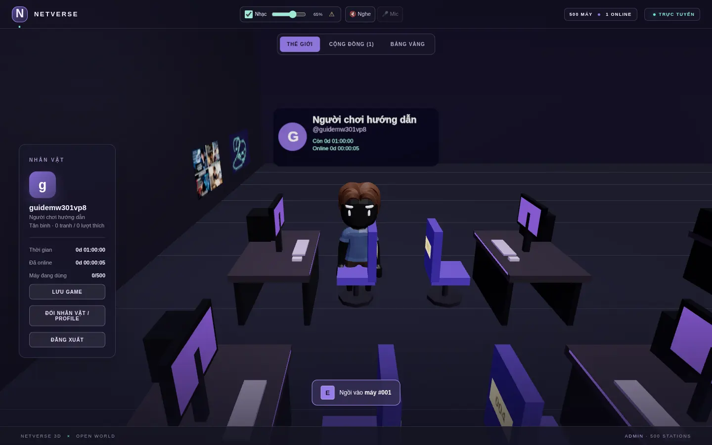
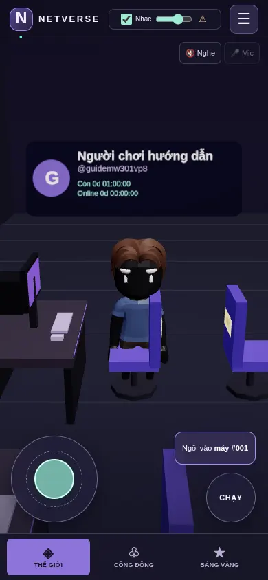
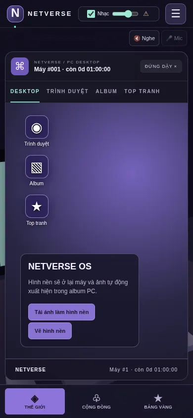
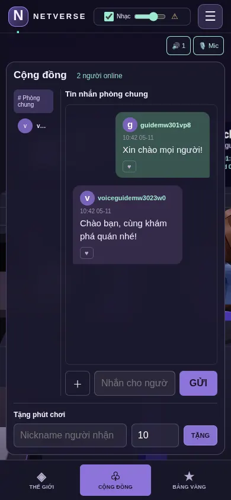
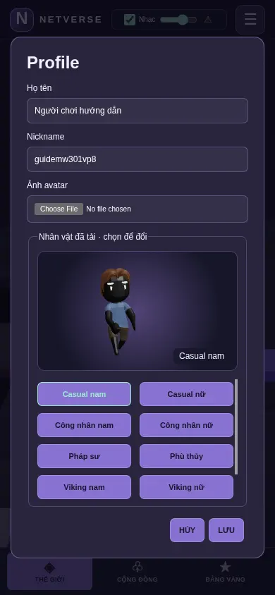

# Hướng dẫn chơi NETVERSE 3D

## 1. Vào quán

Mở trang NETVERSE, tạo tài khoản hoặc đăng nhập. Tài khoản mới có 60 phút. Sau khi vào, nhân vật xuất hiện ở vị trí đã lưu. Thanh bên trái trên máy tính hiển thị thời gian còn lại và nút **Lưu game**; trên điện thoại, mở menu **☰** để lưu hoặc đăng xuất.

## 2. Di chuyển và ngồi vào PC

- **Máy tính:** `W/A/S/D` hoặc phím mũi tên để đi, giữ `Shift` để chạy. Đến gần ghế, nhấn `E` hoặc bấm **Ngồi vào máy**. Nhấn `E` lần nữa hoặc **Đứng dậy** để rời PC.
- **Điện thoại:** kéo cần điều khiển tròn ở góc trái; giữ **CHẠY** ở góc phải nếu muốn chạy. Khi đến gần ghế, chạm **Ngồi vào máy**. Chạm **Đứng dậy** ở đầu cửa sổ PC để rời ghế.

Thời gian chơi chỉ giảm khi ngồi PC. Hết giờ, bạn trở lại ngoài quán; vào **Cộng đồng** để xin người khác tặng phút.

## 3. Dùng PC trong game

PC có **Desktop**, **Trình duyệt**, **Album** và **Top tranh**. Từ Desktop, mở trình duyệt hoặc album; bạn có thể tải/vẽ hình nền. Hình nền và ảnh album ở lại PC cho người đến sau. Trong trình duyệt PC, dán URL hoặc chọn shortcut; video YouTube/TikTok dùng player nhúng của chính nền tảng.

## 4. Chat và tặng phút

Mở tab **Cộng đồng** ở thanh trên máy tính hoặc thanh điều hướng dưới điện thoại. Chọn **Phòng chung** hoặc chọn người đang online để chat riêng. Tin mình gửi nằm bên phải, tin người khác nằm bên trái. Nút `＋` đính ảnh; nút tim ở mỗi tin để bày tỏ cảm xúc. Tin nhắn chỉ gửi cho người đang online và được lưu trên trình duyệt của bạn.

Ở cuối tab Cộng đồng, nhập nickname và số phút rồi bấm **TẶNG** để giúp người khác.

## 5. Nghe nhạc và nói chuyện gần nhau

Checkbox **Nhạc** trên header mặc định bật; kéo thanh âm lượng hoặc bỏ chọn để tắt nhạc. Trình duyệt có thể yêu cầu bấm **Phát nhạc** một lần trước khi cho phát âm thanh. Nếu thấy dấu `⚠`, chạm để xem thông báo nguồn nhạc; admin cần thay bài YouTube cũ bằng URL âm thanh trực tiếp.

Bấm **Nghe** để nghe người trong bán kính 12 đơn vị thế giới; người xa nghe nhỏ dần. Có tối đa 6 kết nối gần nhất. Bấm **Mic** để xin quyền micro và nói; bấm lại để tắt mic. Bạn có thể tắt **Nghe** để rời voice. Trên điện thoại, hai nút voice nằm ngay dưới header. Voice cần trang HTTPS và quyền micro; một số mạng di động cần máy chủ TURN.

## 6. Đổi nhân vật

Trên máy tính, bấm **Đổi nhân vật / Profile** ở thanh bên; trên điện thoại, mở **☰ → Nhân vật / Profile**. Chọn tên nhân vật để xem trước mô hình 3D, rồi bấm **LƯU** để áp dụng. Bạn cũng có thể đổi tên hiển thị và ảnh avatar ở đây.

## 7. Khám phá thêm

Tab **Bảng vàng** có người nhiều phút nhất, người tặng phút nhiều nhất và tranh nổi bật. Trong PC, mở Album hoặc Top tranh, chọn ảnh để phóng to và xem profile tác giả. Người chơi có thể thích tranh để tặng thêm phút cho tác giả.
